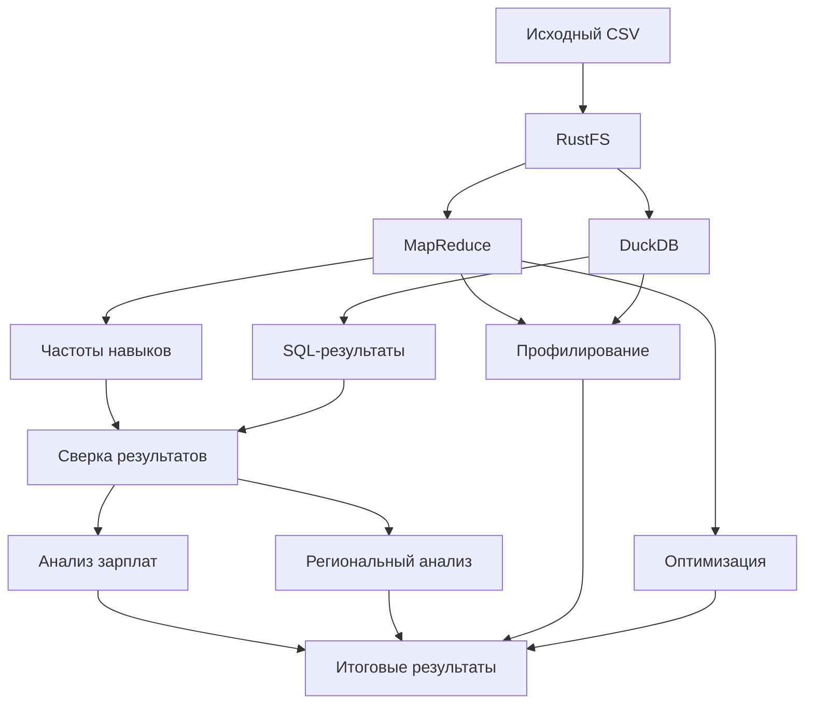
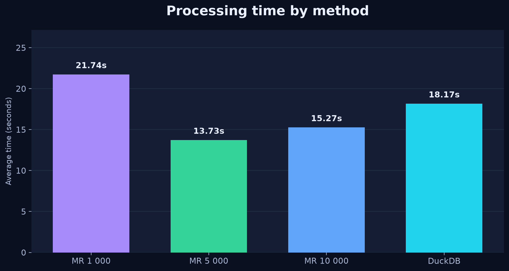
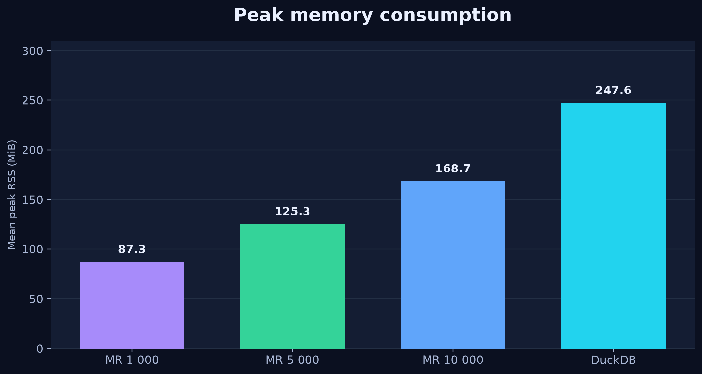
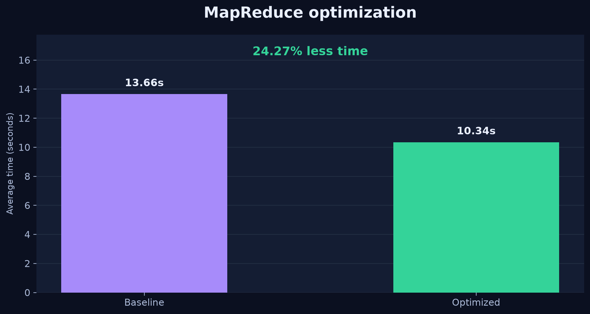

# Анализ вакансий разработчиков мобильных платформ

Домашнее задание №3 по инженерии данных.

**Вариант №9:** Программист, разработчик на мобильных платформах.

## 1. Описание проекта

Цель работы — реализовать обработку данных о вакансиях с использованием объектного хранилища RustFS, собственного алгоритма MapReduce и аналитической СУБД DuckDB.

В рамках работы выполнены:
- Развёртывание объектного хранилища RustFS.
- Загрузка исходного датасета в S3.
- Потоковая обработка данных методом MapReduce.
- Подсчёт частот отдельных навыков, пар и троек навыков.
- Независимая реализация подсчётов с помощью DuckDB.
- Проверка совпадения результатов двух подходов.
- Анализ зарплатных предложений.
- Сравнение вакансий в трёх регионах.
- Профилирование времени выполнения и потребления памяти.
- Оптимизация алгоритма и проверка восстановления после сбоя.

## 2. Используемые технологии

| Технология | Назначение |
|---|---|
| Python | Реализация алгоритмов и обработка данных |
| RustFS | Объектное хранилище с S3 API |
| boto3 | Чтение и запись объектов в RustFS |
| DuckDB | Выполнение независимых SQL-запросов |
| pandas | Обработка результатов |
| psutil | Измерение потребления оперативной памяти |
| matplotlib | Построение графиков |
| Docker | Запуск объектного хранилища |

## 3. Исходные данные

В работе использован исторический датасет вакансий HeadHunter `Raw_Jobs.csv`.

Исходный файл хранится в RustFS:

`s3://hh-lake/raw/Raw_Jobs.csv`

Характеристики данных:

| Показатель | Значение |
|---|---:|
| Исходных записей | 561 989 |
| Размер файла | 1 556 363 336 байт |
| Вакансий после фильтрации | 321 |
| Вакансий с навыками | 262 |
| Удалено повторных записей | 3 |
| Исключено после ручной проверки | 6 |

Для отбора вакансий использовались названия должностей. Дополнительно проверялись неоднозначные вакансии, которые могли относиться к серверной разработке или управлению проектами.

Повторяющиеся вакансии исключались по идентификатору.

## 4. Архитектура решения



Исходный файл читается непосредственно из RustFS. Подсчёты MapReduce и DuckDB выполняются независимо.

## 5. Реализация MapReduce

Алгоритм реализован в файле `src/mapreduce_skills.py`.

Обработка данных выполняется последовательно, чанками заданного размера, без загрузки всего исходного CSV в оперативную память.

На этапе Map выполняются фильтрация вакансий, удаление дубликатов, нормализация навыков и подсчёт комбинаций.

На этапе Reduce локальные счётчики объединяются в итоговые частотные таблицы.

Были проверены размеры чанков:
- 1 000 строк;
- 5 000 строк;
- 10 000 строк.

Результаты каждого варианта сохраняются в RustFS.

Реализация использует подход MapReduce, но не является распределённым вычислительным кластером.

## 6. Результаты подсчёта навыков

| Показатель | Значение |
|---|---:|
| Уникальных навыков | 383 |
| Уникальных пар | 3 674 |
| Уникальных троек | 16 440 |
| Вхождений навыков | 1 622 |
| Вхождений пар | 6 039 |
| Вхождений троек | 19 142 |

Наиболее часто встречающиеся навыки:

| Навык | Количество вакансий |
|---|---:|
| iOS | 106 |
| Git | 104 |
| Swift | 94 |
| Android | 89 |
| Kotlin | 78 |
| ООП | 56 |
| Java | 51 |
| Android SDK | 38 |
| Flutter | 34 |
| Objective-C | 28 |

## 7. Проверка с помощью DuckDB

В файле `src/duckdb_skills.py` реализован независимый SQL-подсчёт навыков, пар и троек.

Для проверки результаты MapReduce сравнивались с результатами DuckDB по каждой комбинации.

| Тип | Проверено комбинаций | Расхождений |
|---|---:|---:|
| Навыки | 383 | 0 |
| Пары | 3 674 | 0 |
| Тройки | 16 440 | 0 |
| Всего | 20 497 | 0 |

Все проверки завершились успешно.

Дополнительно выполнено сравнение SHA-256 выходных CSV-файлов для трёх размеров чанков. Файлы совпали побайтово.

## 8. Анализ заработной платы

Для анализа использовались вакансии с зарплатами в рублях.

Рассматривались два показателя:

1. Середина полного зарплатного интервала.
2. Указанная нижняя граница зарплаты.

После фильтрации:
- 45 вакансий имеют полный интервал зарплаты в рублях.
- 112 вакансий имеют известную нижнюю границу зарплаты.

Для пар и троек навыков рассчитывалась разница медиан относительно базового навыка. Базовым выбирался наиболее часто встречающийся навык комбинации.

Минимальное количество наблюдений для включения комбинации в анализ — три.

Результаты сохранены в каталоге `salary/` объектного хранилища.

Из-за небольшого количества наблюдений полученные различия нельзя интерпретировать как доказательство причинного влияния навыков на заработную плату.

## 9. Региональный анализ

Для сравнения выбраны Москва, Санкт-Петербург и Казань.

| Показатель | Москва | Санкт-Петербург | Казань |
|---|---:|---:|---:|
| Количество вакансий | 49 | 22 | 5 |
| Вакансий с навыками | 45 | 19 | 3 |
| Медиана середины полного интервала, руб. | 92 500 | 170 000 | 145 000 |
| Медиана нижней границы, руб. | 70 000 | 140 000 | 85 000 |

В Москве наиболее часто встречаются iOS и Swift.

В Санкт-Петербурге Android, Git, iOS и Swift встречаются с одинаковой частотой.

Из-за малого числа вакансий в Казани и ограниченного количества зарплатных наблюдений региональные показатели следует интерпретировать осторожно.

## 10. Профилирование производительности

Для каждого подхода выполнено по три запуска. Измерялись время выполнения и пиковое потребление оперативной памяти процесса.

| Метод | Среднее время, с | Средняя пиковая RSS, МиБ |
|---|---:|---:|
| MapReduce, 1000 | 21,744 | 87,34 |
| MapReduce, 5000 | 13,733 | 125,34 |
| MapReduce, 10000 | 15,270 | 168,67 |
| DuckDB | 18,169 | 247,62 |

Наименьшее среднее время в проведённых измерениях показал MapReduce с чанком 5000 строк.

Наименьшее потребление памяти наблюдалось при размере чанка 1000 строк.

### Время выполнения



### Потребление оперативной памяти



## 11. Оптимизация алгоритма

В файле `src/mapreduce_optimized.py` реализована оптимизированная последовательная обработка.

Вместо создания промежуточных счётчиков для каждого чанка данные сразу добавляются в итоговые счётчики.

Для сравнения исходная и оптимизированная версии запускались по три раза при размере чанка 5000 строк.

| Показатель | Исходная версия | Оптимизированная |
|---|---:|---:|
| Среднее время, с | 13,659 | 10,344 |
| Средняя пиковая RSS, МиБ | 125,68 | 123,74 |

В проведённом эксперименте среднее время сократилось на 24,27%.

Результаты оптимизированной и исходной версий совпали побайтово.



## 12. Проверка отказа маппера

Для тестирования отказоустойчивости был смоделирован сбой маппера.

Проверено:
- вычисление завершилось с ненулевым кодом;
- ранее сохранённые результаты в RustFS не изменились;
- после исправления ошибки повторный запуск выполнился успешно;
- восстановленные результаты совпали с исходными по SHA-256.

Восстановление реализовано полным повторным запуском программы, без продолжения с контрольной точки.

## 13. Структура проекта

```text
hw3/
├── src/
│   ├── config.py
│   ├── variant_filter.py
│   ├── vacancy_quality.py
│   ├── mapreduce_skills.py
│   ├── mapreduce_baseline.py
│   ├── mapreduce_optimized.py
│   ├── duckdb_skills.py
│   ├── verify_results.py
│   ├── verify_chunk_sizes.py
│   ├── salary_analysis.py
│   ├── regional_analysis.py
│   ├── profile_runs.py
│   ├── benchmark_optimization.py
│   ├── test_mapper_failure.py
│   └── create_figures.py
├── results/
│   ├── figures/
│   ├── profiling/
│   └── optimization/
├── .env.example
├── .gitignore
├── requirements.txt
└── README.md
```

## 14. Установка и запуск

Необходимо установить Python и запустить RustFS с доступным S3 API.

Создание виртуального окружения:

```bash
python3 -m venv .venv
source .venv/bin/activate
python -m pip install -r requirements.txt
```

Создание локальной конфигурации:

```bash
cp .env.example .env
```

В `.env` необходимо указать параметры подключения к RustFS.

Исходный файл `Raw_Jobs.csv` должен быть загружен в бакет `hh-lake` по ключу `raw/Raw_Jobs.csv`.

Проверка подключения:

```bash
python -m src.check_s3
```

Запуск MapReduce:

```bash
python -m src.mapreduce_skills --chunk-size 5000
```

Запуск DuckDB:

```bash
python -m src.duckdb_skills
```

Проверка результатов:

```bash
python -m src.verify_results
python -m src.verify_chunk_sizes
```

Аналитика:

```bash
python -m src.salary_analysis
python -m src.regional_analysis
```

Профилирование:

```bash
python -m src.profile_runs
python -m src.benchmark_optimization
```

Проверка восстановления после сбоя:

```bash
python -m src.test_mapper_failure
```

Построение графиков:

```bash
python -m src.create_figures
```

## 15. Ограничения

- Исходный датасет исторический и не отражает текущее состояние рынка труда.
- Не у всех вакансий заполнены навыки и зарплатные предложения.
- Регион известен не для каждой вакансии.
- Зарплаты в разных валютах не объединялись.
- Анализ зарплат ограничен небольшими выборками.
- Время выполнения зависит от состояния компьютера, кэша и нагрузки системы.
- MapReduce реализован в виде последовательной потоковой обработки.

## 16. Итоги

В работе реализован аналитический пайплайн на базе RustFS, Python и DuckDB.

Проведён подсчёт частот навыков, пар и троек навыков для вакансий разработчиков мобильных платформ.

Результаты собственной реализации MapReduce совпали с независимыми SQL-расчётами DuckDB. Проверена независимость результатов от размера чанка.

Выполнены анализ зарплат, региональное сравнение, профилирование, оптимизация вычислений и тест восстановления после сбоя.
