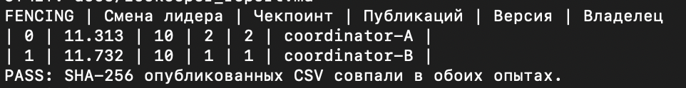

# Обеспечение отказоустойчивости средствами Apache ZooKeeper

## Цель и среда

Ансамбль из трёх серверов ZooKeeper 3.9.6 запущен через Docker Compose.
Java 17 находится внутри образа `zookeeper:3.9.6-jre-17`.
Клиентское приложение написано на Python с библиотекой Kazoo.
Исходные данные и объекты чекпоинтов хранятся в RustFS.
Работа продолжает ДЗ № 3: анализ вакансий разработчиков мобильных платформ, вариант № 9.

## 1. Ансамбль

Конфигурация: [compose.zookeeper.yaml](../compose.zookeeper.yaml).
Все серверы используют одинаковый список участников `ZOO_SERVERS`, разные
`ZOO_MY_ID` (1, 2, 3) и отдельные тома `/data` и `/datalog`.
Официальный образ создаёт `myid` по `ZOO_MY_ID`.
Снаружи доступны порты 2181, 2182, 2183; внутри контейнеров клиентский порт — 2181.
Лидер ансамбля ZooKeeper и активный координатор приложения — разные роли.

При первоначальной проверке `zk3` был лидером, `zk1` и `zk2` — последователями.
После остановки `zk1` два оставшихся сервера сохраняли роли follower и leader.
После остановки второго сервера и ожидания 20 секунд `zk3` выдавал:

```text
Error contacting service. It is probably not running.
```

При этом контейнер `zk3` оставался в состоянии Up. Это означает потерю кворума,
а не обязательное завершение процесса. При немедленной проверке после отключения
второго узла сервер ещё показывал прежнюю роль leader; повторная проверка после
ожидания зафиксировала недоступность. После запуска серверов ансамбль восстановился.

Сохранённые проверки: [logs/ensemble](../logs/ensemble).
Подробное подтверждение потери кворума:
[logs/ensemble/two-down-after-wait.txt](../logs/ensemble/two-down-after-wait.txt),
[logs/ensemble/two-down-containers.txt](../logs/ensemble/two-down-containers.txt),
[logs/ensemble/two-down-zk3.log](../logs/ensemble/two-down-zk3.log).

## 2. Эфемерный узел

Выписка из интерактивного терминала при выполнении работы:

```text
[zk: zk1:2181(CONNECTED) 0] create -e /hw4-ephemeral "session-alive"
Created /hw4-ephemeral
[zk: zk1:2181(CONNECTED) 1] get -s /hw4-ephemeral
session-alive
cZxid = 0x300000002
dataVersion = 0
ephemeralOwner = 0x1000008bc9f0000
dataLength = 13
numChildren = 0
```

После `quit` и подключения новым клиентом через `zk2`:

```text
[zk: zk2:2181(CONNECTED) 0] get /hw4-ephemeral
Node does not exist: /hw4-ephemeral
```

Ненулевой `ephemeralOwner` указывает на принадлежность узла сессии.
При штатном закрытии сессии узел удаляется. При приостановке процесса сессия
удаляется ансамблем после истечения тайм-аута, поскольку клиент не поддерживает связь.

## 3. Выбор координатора и восстановление

Код: [src/zk_coordinator.py](../src/zk_coordinator.py), [src/zk_state.py](../src/zk_state.py).
Сценарий опытов: [src/zk_experiment.py](../src/zk_experiment.py).
Тайм-аут сессии координаторов задан как 10 секунд.

Каждый опыт использует отдельный путь `/hh-hw4/<run-id>`:

- `leader` — эфемерный узел с именем активного координатора;
- `epoch` — постоянный счётчик поколений лидера;
- `checkpoint` — указатель на последний принятый чекпоинт в RustFS;
- `result` — указатель на опубликованный результат;
- `config` — параметры обработки и идентификатор исходного объекта.

Захват лидерства и увеличение эпохи выполняются одной транзакцией.
Эпоха приложения соответствует версии данных узла `epoch`; это собственный fencing
токен приложения, а не внутренняя эпоха протокола ZooKeeper.

Чекпоинт содержит номер последнего обработанного чанка, ID уже учтённых вакансий,
счётчики навыков, пар, троек и статистику. Он сохраняется каждые пять чанков.
Содержимое находится в RustFS, а публикация указателя на него защищена проверкой
эпохи в обоих режимах, чтобы устаревший процесс не откатывал прогресс.

Резервный координатор загружает счётчики из чекпоинта. CSV технически перечитывается
до его границы, но уже учтённые чанки не передаются в mapper и повторно не суммируются.
Для демонстрации в обработку добавлена задержка 0,15 секунды на новый чанк.

## 4. Опыты с приостановкой лидера

Сценарий запускает A, дожидается чекпоинта не менее 10 чанков, запускает B,
дожидается его готовности и отправляет A сигнал SIGSTOP. Приостанавливается весь
процесс A, включая клиентские потоки ZooKeeper. После истечения сессии узел leader
исчезает, B становится лидером с эпохой 2 и завершает расчёт с чекпоинта.
A возобновляется сигналом SIGCONT после завершения B и не ранее чем через 40 секунд
после остановки.

Время переключения измерено монотонными часами от отметки непосредственно перед
отправкой SIGSTOP до события LEADER резервного процесса. Оба процесса работают
на одном компьютере. Небольшой интервал записи отметки и отправки сигнала входит
в измерение. Интервал включает обнаружение истечения сессии и захват лидерства,
поэтому он не обязан точно равняться тайм-ауту сессии.

| FENCING | Смена лидера, с | Чанков в восстановлении | Публикаций | Версия указателя | Итоговый владелец |
|---|---:|---:|---:|---:|---|
| 0 | 11.313 | 10 | 2 | 2 | coordinator-A |
| 1 | 11.732 | 10 | 1 | 1 | coordinator-B |

Без защиты резервный B публикует результат первым, версия указателя становится 1.
После возобновления A со старой эпохой 1 также публикует результат: в журналах две
строки «записал результат», версия указателя становится 2, владелец — A.

С защитой B публикует результат с эпохой 2. При попытке A опубликовать результат
с эпохой 1 транзакция отклоняется с BadVersionError. Версия указателя остаётся 1,
владелец — B. Событие отказа отражено в журнале A как REJECTED.

Отдельные CSV каждого процесса записываются по уникальным ключам в RustFS.
Принятием результата считается успешное изменение общего указателя `result`.
Неопубликованные объекты могут оставаться в RustFS, но не заменяют принятый результат.

## 5. Совпадение с ДЗ № 3

Перед публикацией каждый координатор побайтово сравнивает все три CSV с эталоном
`baseline/hw3`, сохранённым после запуска исходного расчёта ДЗ № 3.
Сценарий дополнительно скачивает опубликованные CSV и сравнивает их с эталоном.
События VERIFIED присутствуют у обоих координаторов в обоих опытах.

| Показатель | Значение |
|---|---:|
| Всего строк | 561989 |
| Отобрано вакансий | 321 |
| Удалено дубликатов | 3 |
| Вакансий с навыками | 262 |
| Уникальных навыков | 383 |
| Уникальных пар | 3674 |
| Уникальных троек | 16440 |
| Вхождений навыков | 1622 |
| Вхождений пар | 6039 |
| Вхождений троек | 19142 |

| Файл | SHA-256 в обоих опытах |
|---|---|
| skills.csv | `be838913b86010efb0e17767933894ea641682e1ad04b6a3c1296b3fc9095fba` |
| pairs.csv | `2e889e18e7913757aa79678cc46c8b69915714375267be957b3fd8cd91d1cc94` |
| triples.csv | `2387a3f508ed1e5c9ac28f9b7932da30e7fe3c5744da7599a3c8f4570ba8bce5` |

## 6. Почему серверов три, а не два и не четыре?

Для работы нужно строгое большинство: `floor(N / 2) + 1`.

| Серверов | Нужно для кворума | Допустимо отказов |
|---|---:|---:|
| 2 | 2 | 0 |
| 3 | 2 | 1 |
| 4 | 3 | 1 |

Из двух серверов нельзя потерять ни одного. Три — минимальное количество,
позволяющее пережить один отказ. Четвёртый голосующий сервер расходует ресурсы,
но число допустимых отказов остаётся тем же. Для двух отказов нужны пять серверов.
В данной работе контейнеры стоят на одном компьютере: проверяется отказ отдельных
процессов, а отказ всего компьютера остановит весь ансамбль.

## 7. Почему эпоху должен проверять получатель записи?

Потеря сессии не выключает старого координатора. После паузы он может продолжить
работу и отправить уже подготовленную запись. Даже проверка своего лидерства
непосредственно перед записью недостаточна: между проверкой и записью возможна
пауза, за которую лидер сменится. Поэтому принимающая сторона должна атомарно
проверить fencing токен и принять либо отклонить изменение.

ZooKeeper сам по себе не проверяет записи, отправляемые в стороннюю базу или S3.
Если общий изменяемый результат хранить там, проверку нужно реализовать в том
хранилище или сервисе, который принимает запись.

В этой реализации изменяемым опубликованным результатом является указатель
в ZooKeeper. Поэтому именно ZooKeeper является получателем этого изменения:
одна транзакция делает `check(epoch, старая_версия)` и `set_data(result, указатель)`.
При несовпадении версии весь набор операций отклоняется. Это защищает публикацию
указателя; ZooKeeper не запрещает загрузку отдельных неопубликованных CSV в RustFS.
Здесь защита обеспечивается явным условием транзакции, а не одним фактом выбора лидера.

## 8. Повторение опытов

Из корня репозитория с активированным окружением и заполненным `.env`:

```bash
python -m pip install -r requirements.txt
docker compose -f compose.zookeeper.yaml up -d
docker start rustfs-server
python -m src.check_s3
python -m src.zk_experiment --fencing 0
python -m src.zk_experiment --fencing 1
python -m src.zk_report
```

Исходный объект `s3://hh-lake/raw/Raw_Jobs.csv` и эталонные CSV должны быть доступны.
RustFS — существующее хранилище из ДЗ № 3; его имя контейнера относится к данной
локальной установке. Исходный CSV размером около 1,56 ГБ в Git не добавляется.
Каждый опыт автоматически создаёт новый run-id.

## 9. Журналы и результаты

Эталон: [baseline/hw3](../baseline/hw3); запуск ДЗ № 3: [logs/hw3-baseline.log](../logs/hw3-baseline.log).
Журналы содержат временные отметки, PID, эпохи, чекпоинты, результаты проверки
и решение о публикации. `experiment.jsonl` содержит SIGSTOP, SIGCONT и время переключения.

- [logs/unsafe-20261102-215235-35cba1/summary.json](../logs/unsafe-20261102-215235-35cba1/summary.json)
- [logs/unsafe-20261102-215235-35cba1/experiment.jsonl](../logs/unsafe-20261102-215235-35cba1/experiment.jsonl)
- [logs/unsafe-20261102-215235-35cba1/coordinator-A.jsonl](../logs/unsafe-20261102-215235-35cba1/coordinator-A.jsonl)
- [logs/unsafe-20261102-215235-35cba1/coordinator-B.jsonl](../logs/unsafe-20261102-215235-35cba1/coordinator-B.jsonl)
- [logs/unsafe-20261102-215235-35cba1/coordinator-A-console.log](../logs/unsafe-20261102-215235-35cba1/coordinator-A-console.log)
- [logs/unsafe-20261102-215235-35cba1/coordinator-B-console.log](../logs/unsafe-20261102-215235-35cba1/coordinator-B-console.log)
- [logs/fenced-20261102-215343-03c4eb/summary.json](../logs/fenced-20261102-215343-03c4eb/summary.json)
- [logs/fenced-20261102-215343-03c4eb/experiment.jsonl](../logs/fenced-20261102-215343-03c4eb/experiment.jsonl)
- [logs/fenced-20261102-215343-03c4eb/coordinator-A.jsonl](../logs/fenced-20261102-215343-03c4eb/coordinator-A.jsonl)
- [logs/fenced-20261102-215343-03c4eb/coordinator-B.jsonl](../logs/fenced-20261102-215343-03c4eb/coordinator-B.jsonl)
- [logs/fenced-20261102-215343-03c4eb/coordinator-A-console.log](../logs/fenced-20261102-215343-03c4eb/coordinator-A-console.log)
- [logs/fenced-20261102-215343-03c4eb/coordinator-B-console.log](../logs/fenced-20261102-215343-03c4eb/coordinator-B-console.log)

Опубликованные CSV каждого опыта также скачаны в его подкаталог `result`.

## 10. Документация

- [ZooKeeper Administrator's Guide](https://zookeeper.apache.org/doc/current/zookeeperAdmin.html)
- [ZooKeeper Programmer's Guide](https://zookeeper.apache.org/doc/current/zookeeperProgrammers.html)
- [Kazoo API](https://kazoo.readthedocs.io/en/latest/api/client.html)

## 11. Скриншот результатов


